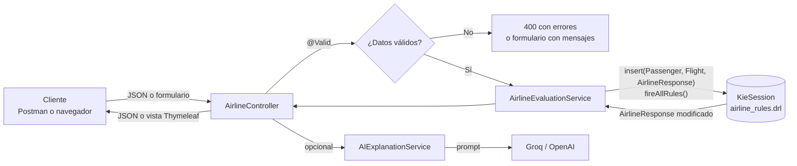

# Laboratorio 2: Reglas de negocio de una aerolínea con Spring Boot y Drools

Universidad de Antioquia, Facultad de Ingeniería, Ingeniería de Sistemas.
Curso **Fundamentos de Sistemas de Información**, 2026-2.
Autor: **Isaac Cano Orozco** (i.cano@udea.edu.co).

Esta aplicación web evalúa a un pasajero y su vuelo con **10 reglas de negocio** escritas en Drools (DRL). Decide, entre otras cosas, si el pasajero asciende de clase, qué asiento recibe, si obtiene descuentos, compensaciones o puntos, y si su equipaje está permitido. Las reglas viven en un archivo aparte del código Java, así que la política de la aerolínea se puede cambiar sin tocar la lógica de la aplicación. Si se pide, un modelo de lenguaje explica el resultado en español.

## Contenido

- [Tecnologías](#tecnologías)
- [Requisitos](#requisitos)
- [Inicio rápido](#inicio-rápido)
- [Configuración](#configuración)
- [Arquitectura](#arquitectura)
- [Estructura del proyecto](#estructura-del-proyecto)
- [Modelo de hechos](#modelo-de-hechos)
- [Reglas de negocio](#reglas-de-negocio)
- [API REST](#api-rest)
- [Interfaz web](#interfaz-web)
- [Explicación con IA](#explicación-con-ia)
- [Pruebas](#pruebas)
- [Solución de problemas](#solución-de-problemas)
- [Decisiones de diseño](#decisiones-de-diseño)

## Tecnologías

| Capa | Tecnología |
|------|------------|
| Aplicación | Spring Boot 3.5.16, Java 17 |
| Motor de reglas | Drools 10.2.0 (KIE API: `KieContainer`, `KieSession`) |
| Validación | Jakarta Bean Validation |
| Vistas web | Thymeleaf y Bootstrap 5.3 |
| IA | Spring AI 1.1.2 con Groq (API compatible con OpenAI), modelo `openai/gpt-oss-120b` |
| Pruebas | JUnit 5 (`spring-boot-starter-test`) y una colección de Postman |
| Construcción | Maven 3.9 o superior |

## Requisitos

- **JDK 17 o superior.** El proyecto compila con `java.version` 17 y se probó con JDK 21 y 24.
- **Maven 3.9 o superior** en el `PATH`.
- Opcional: una **API key gratuita de Groq** para la explicación con IA. Sin ella la aplicación funciona igual.
- Opcional: **Postman**, para las pruebas manuales de la API.

## Inicio rápido

```bash
git clone https://github.com/Isaac200301/lab2fsi.git
cd lab2fsi
mvn spring-boot:run
```

Luego abra http://localhost:8080. La raíz redirige al formulario `/airline/form`.

Para activar la explicación con IA, defina la variable `AI_API_KEY` **antes** de arrancar la aplicación (ver [Configuración](#configuración)).

## Configuración

Toda la configuración está en [`src/main/resources/application.yaml`](src/main/resources/application.yaml) y se sobrescribe con variables de entorno. Así ninguna clave queda escrita en el repositorio.

| Variable | Obligatoria | Valor por defecto | Descripción |
|----------|-------------|-------------------|-------------|
| `AI_API_KEY` | No | `sin-configurar` | API key del proveedor de IA. Sin ella, la explicación indica que falta configurarla. |
| `AI_BASE_URL` | No | `https://api.groq.com/openai` | URL de cualquier API compatible con OpenAI. |
| `AI_MODEL` | No | `openai/gpt-oss-120b` | Modelo que se usa para la explicación. |

**Windows (PowerShell)**

```powershell
# Solo para la terminal actual
$env:AI_API_KEY = "gsk_..."
mvn spring-boot:run

# Permanente para el usuario (aplica a terminales que se abran después)
setx AI_API_KEY "gsk_..."
```

**Linux y macOS**

```bash
export AI_API_KEY="gsk_..."
mvn spring-boot:run
```

La clave de Groq se obtiene gratis en https://console.groq.com/keys. Para usar OpenAI en su lugar, defina `AI_BASE_URL=https://api.openai.com` y `AI_MODEL=gpt-4o-mini`.

> No suba la API key al repositorio. El `.gitignore` ya excluye los archivos `.env`.

## Arquitectura



Una evaluación sigue estos pasos:

1. El **controlador** recibe la petición, y Spring valida los datos con Bean Validation. Si algo es inválido, la petición no llega al motor de reglas.
2. El **servicio** crea un `AirlineResponse` cuyo precio final es el precio del tiquete. Luego abre una `KieSession` nueva, inserta los tres hechos, ejecuta `fireAllRules()` y libera la sesión con `dispose()`.
3. Cada **regla** que se cumple modifica la respuesta y registra su nombre y un mensaje con `addRule(...)`.
4. Si se pidió, el **servicio de IA** envía al modelo los datos, las reglas activadas y el catálogo de reglas, y devuelve una explicación en texto.
5. El controlador responde con **JSON** (API) o con la **vista de resultados** (web).

`DroolsConfig` compila el `.drl` **una sola vez** al arrancar y publica el `KieContainer` como bean. Si el archivo de reglas tiene errores, la aplicación no arranca y muestra los mensajes del compilador.

## Estructura del proyecto

```
lab2fsi/
├── pom.xml                                  Dependencias: Spring Boot, Drools, Spring AI
├── postman/
│   └── Lab2-Aerolinea.postman_collection.json   12 peticiones de prueba
└── src/
    ├── main/
    │   ├── java/com/udea/labdrools/
    │   │   ├── LabdroolsApplication.java    Punto de entrada
    │   │   ├── config/
    │   │   │   └── DroolsConfig.java        Compila el .drl y crea el KieContainer
    │   │   ├── model/
    │   │   │   ├── Passenger.java           Hecho de entrada: pasajero
    │   │   │   ├── Flight.java              Hecho de entrada: vuelo
    │   │   │   ├── AirlineResponse.java     Hecho de salida que las reglas modifican
    │   │   │   ├── AirlineRequest.java      Cuerpo de la petición
    │   │   │   └── ExplainedResponse.java   Resultado + explicación de la IA
    │   │   ├── service/
    │   │   │   └── AirlineEvaluationService.java   Ejecuta las reglas
    │   │   ├── ai/
    │   │   │   └── AIExplanationService.java       Prompt y llamada al modelo
    │   │   └── controller/
    │   │       ├── AirlineController.java   Endpoints REST y formulario web
    │   │       └── HomeController.java      Redirige "/" al formulario
    │   └── resources/
    │       ├── application.yaml             Configuración (IA por variables de entorno)
    │       ├── rules/airline_rules.drl      Las 10 reglas de negocio
    │       └── templates/                   airline_form.html, airline_result.html
    └── test/java/com/udea/labdrools/
        ├── AirlineRulesTest.java            14 pruebas de las reglas
        └── LabdroolsApplicationTests.java   Arranque del contexto
```

Todas las clases y métodos públicos tienen Javadoc. Para generar la documentación HTML en `target/site/apidocs/` ejecute:

```bash
mvn javadoc:javadoc
```

## Modelo de hechos

Los **hechos** son los objetos sobre los que razona Drools. Se insertan tres en cada sesión.

### `Passenger` (entrada)

| Atributo | Tipo | Validación | Usado por |
|----------|------|------------|-----------|
| `name` | String | Obligatorio, 2 a 100 caracteres | Mensajes |
| `age` | int | 0 a 120 | Reglas 2 y 5 |
| `membershipStatus` | String | `Basic`, `Silver`, `Gold` o `Platinum` | Reglas 1, 7 y 9 |
| `seatPreference` | String | `Any` (sin preferencia), `Window` o `Aisle` | Reglas 5 y 10 |
| `travelingWithChildren` | boolean | | Reglas 5 y 10 |
| `luggageWeight` | double | Mayor o igual a 0 (kg) | Reglas 3, 4 y 8 |

### `Flight` (entrada)

| Atributo | Tipo | Validación | Usado por |
|----------|------|------------|-----------|
| `flightNumber` | String | Obligatorio | Mensajes |
| `delayMinutes` | int | Mayor o igual a 0 | Reglas 1 y 6 |
| `durationHours` | double | Mayor o igual a 0.1 | Reglas 7 y 8 |
| `emergencyExitSeatAvailable` | boolean | | Regla 5 (que lo pasa a `false`) |
| `ticketPrice` | double | Mayor o igual a 0 | Regla 3 |

### `AirlineResponse` (salida)

| Atributo | Valor inicial | Lo cambia |
|----------|---------------|-----------|
| `seatClass` | `Económica` | Regla 1 |
| `priorityCheckIn` | `false` | Regla 2 |
| `discountPercentage`, `finalPrice` | `0`, precio del tiquete | Regla 3 |
| `upgradeEligible` | `true` | Regla 4 |
| `assignedSeat` | `Asignación estándar` | Reglas 5 y 10 |
| `compensation` | `0` | Regla 6 |
| `extraLoyaltyPoints` | `0` | Regla 7 |
| `luggageAllowed` | `true` | Regla 8 |
| `vipLoungeAccess` | `false` | Regla 9 |
| `appliedRules`, `messages` | vacías | Todas (`addRule`) |

## Reglas de negocio

Todas están en [`src/main/resources/rules/airline_rules.drl`](src/main/resources/rules/airline_rules.drl). Los umbrales son estrictos, como en el enunciado: "más de 60 minutos" significa `> 60`.

| # | Regla | Condición | Acción |
|---|-------|-----------|--------|
| 1 | `UpgradeToBusinessClassForFrequentFlyersWithDelays` | Membresía Gold o Platinum, retraso > 60 min y `upgradeEligible == true` | `seatClass = "Ejecutiva"` |
| 2 | `PriorityCheckInForSeniors` | Edad > 65 | Check-in prioritario |
| 3 | `DiscountForLightLuggage` | Equipaje < 10 kg | 10 % de descuento sobre el tiquete |
| 4 | `DenyUpgradeForOverweightLuggage` (salience 100) | Equipaje > 23 kg | `upgradeEligible = false` |
| 5 | `AssignEmergencyExitSeatToYoungAdults` | Edad entre 18 y 40, preferencia `Any`, sin niños y salida de emergencia disponible | Asigna la salida de emergencia y la marca como ocupada |
| 6 | `CompensationForExtremeDelays` | Retraso > 180 min | Compensación de $200 |
| 7 | `ExtraLoyaltyPointsForLongFlights` | Membresía distinta de Basic y vuelo > 5 h | 500 puntos de lealtad |
| 8 | `RestrictLuggageOnShortFlights` | Equipaje > 15 kg y vuelo < 2 h | Equipaje no permitido |
| 9 | `VipLoungeAccessForPlatinumMembers` | Membresía Platinum | Acceso al salón VIP |
| 10 | `PreferentialSeatForFamilies` | Viaja con niños y preferencia `Any` | Asiento preferencial para familias |

### Conflictos entre reglas y cómo se resolvieron

- **Reglas 1 y 4.** Un pasajero Gold con retraso y 25 kg de equipaje cumple las dos condiciones, pero no debe ascender. La Regla 4 tiene `salience 100`, así que se ejecuta primero. Cambia la respuesta con `modify(...)`, y eso obliga a Drools a reevaluar las demás reglas. La Regla 1 exige `upgradeEligible == true` en su condición, por lo que ya no se activa. `no-loop` evita que la Regla 4 se vuelva a disparar con su propio cambio.
- **Reglas 5 y 10.** Un pasajero joven, con niños y sin preferencia de asiento cumplía las dos, y el asiento final dependía del orden de ejecución. Se agregó `travelingWithChildren == false` a la Regla 5, siguiendo la norma de seguridad aérea que no permite asignar la salida de emergencia a quien viaja con menores. Es la única condición que se añadió al enunciado.

### Cómo agregar o cambiar una regla

1. Edite `airline_rules.drl`. Si la regla necesita un dato nuevo, agréguelo al hecho correspondiente en `model/`, con su validación.
2. En el `then`, registre la activación con `$response.addRule(drools.getRule().getName(), "mensaje")`.
3. Si la regla cambia un hecho que otras reglas evalúan, use `modify(...)` en lugar del setter, para que Drools reevalúe esas reglas.
4. Agregue la regla al catálogo de `PROMPT_TEMPLATE` en `AIExplanationService`, para que la IA la conozca.
5. Escriba su prueba en `AirlineRulesTest` y ejecute `mvn test`.

## API REST

Base: `http://localhost:8080/airline/api`. Las peticiones y las respuestas son JSON (`Content-Type: application/json`).

| Método | Ruta | Descripción | Respuesta |
|--------|------|-------------|-----------|
| POST | `/evaluate` | Evalúa solo con las reglas de Drools | `AirlineResponse` |
| POST | `/evaluate-ai` | Evalúa y añade la explicación de la IA | `{ "result": AirlineResponse, "aiExplanation": "..." }` |

### Ejemplo de petición

```http
POST /airline/api/evaluate
Content-Type: application/json

{
  "passenger": {
    "name": "Sofía Ramírez",
    "age": 30,
    "membershipStatus": "Gold",
    "seatPreference": "Window",
    "travelingWithChildren": false,
    "luggageWeight": 25
  },
  "flight": {
    "flightNumber": "AV123",
    "delayMinutes": 90,
    "durationHours": 3,
    "emergencyExitSeatAvailable": false,
    "ticketPrice": 500
  }
}
```

### Respuesta `200 OK`

Este pasajero es Gold y tiene 90 minutos de retraso, pero no asciende, porque su equipaje supera los 23 kg (conflicto entre las reglas 1 y 4):

```json
{
  "seatClass": "Económica",
  "priorityCheckIn": false,
  "discountPercentage": 0.0,
  "finalPrice": 500.0,
  "upgradeEligible": false,
  "assignedSeat": "Asignación estándar",
  "compensation": 0.0,
  "extraLoyaltyPoints": 0,
  "luggageAllowed": true,
  "vipLoungeAccess": false,
  "appliedRules": ["DenyUpgradeForOverweightLuggage"],
  "messages": ["No elegible para ascensos por equipaje con sobrepeso (25.0 kg)."]
}
```

### Respuesta `400 Bad Request`

Si los datos no son válidos (por ejemplo, un nombre vacío y la membresía `Diamond`), el motor de reglas no se ejecuta y se devuelven todos los errores. El orden de los mensajes puede variar.

```json
{
  "errors": [
    "La membresía debe ser Basic, Silver, Gold o Platinum",
    "El nombre debe tener entre 2 y 100 caracteres",
    "El nombre no puede estar vacío"
  ]
}
```

### Ejemplo con `curl`

```bash
curl -X POST http://localhost:8080/airline/api/evaluate \
  -H "Content-Type: application/json" \
  -d '{"passenger":{"name":"Rosa Mendez","age":70,"membershipStatus":"Basic","seatPreference":"Window","travelingWithChildren":false,"luggageWeight":12},"flight":{"flightNumber":"AV123","delayMinutes":0,"durationHours":3,"emergencyExitSeatAvailable":false,"ticketPrice":500}}'
```

## Interfaz web

| Ruta | Descripción |
|------|-------------|
| `GET /` | Redirige a `/airline/form` |
| `GET /airline/form` | Formulario con los datos del pasajero y del vuelo |
| `POST /airline/evaluate` | Muestra el resultado, las reglas activadas y, si se marcó la casilla, la explicación de la IA |

Si un dato es inválido, el formulario se vuelve a mostrar con el mensaje bajo el campo correspondiente.

## Explicación con IA

`AIExplanationService` usa el `ChatClient` de Spring AI con el cliente de OpenAI, apuntado a Groq. El prompt incluye:

- los datos del pasajero y del vuelo;
- los mensajes de las reglas que se activaron;
- el **catálogo de las 10 reglas** con sus condiciones, y la instrucción de no inventar criterios ni usar Markdown.

El modelo a veces responde con negritas de Markdown (`**texto**`) aunque se le pida texto plano, así que el servicio las quita antes de devolver la explicación.

La IA **solo explica**: las decisiones siempre las toma Drools. Si no hay API key, se agotó la cuota o el proveedor falla, el campo `aiExplanation` indica el motivo y la evaluación se entrega igual. El error queda registrado en el log.

## Pruebas

### Automáticas

```bash
mvn test
```

Se ejecutan 15 pruebas contra el motor de reglas real:

- `AirlineRulesTest` (14): parte de un pasajero base que no activa ninguna regla y cambia solo los datos necesarios en cada caso. Cubre las 10 reglas, los límites (retraso de exactamente 60 minutos, membresía Basic, sin salida de emergencia disponible) y los conflictos 1 contra 4 y 5 contra 10.
- `LabdroolsApplicationTests` (1): verifica que el contexto arranca, lo que incluye compilar el `.drl`.

### Manuales con Postman

1. En Postman, use **Import** y seleccione [`postman/Lab2-Aerolinea.postman_collection.json`](postman/Lab2-Aerolinea.postman_collection.json).
2. Arranque la aplicación con `mvn spring-boot:run`.
3. Ejecute las peticiones. La colección define la variable `baseUrl = http://localhost:8080`.

| Petición | Qué verifica |
|----------|--------------|
| Test 01 a Test 10 | Una regla cada una, partiendo del mismo pasajero base |
| Test 11 | Validación: responde `400` con la lista de errores |
| Test 12 | Varias reglas a la vez y la explicación de la IA (`/evaluate-ai`) |

## Solución de problemas

| Síntoma | Causa probable | Solución |
|---------|----------------|----------|
| `aiExplanation`: "configure la variable de entorno AI_API_KEY" | La aplicación se arrancó desde una terminal abierta antes de `setx` | Abra una terminal nueva o ejecute `$env:AI_API_KEY = [Environment]::GetEnvironmentVariable('AI_API_KEY','User')` y reinicie la aplicación |
| `aiExplanation` con un error 429 | Cuota del proveedor agotada | Espere o use otra clave o proveedor |
| `aiExplanation` con un error de modelo no encontrado | El proveedor retiró el modelo | Defina `AI_MODEL` con un modelo activo |
| La aplicación no arranca: "Errores en las reglas Drools" | Error de sintaxis en `airline_rules.drl` | Revise la línea que indica el mensaje |
| `invalid target release: 17` | Maven usa un JDK anterior a 17 | Configure `JAVA_HOME` con JDK 17 o superior |
| `Port 8080 was already in use` | Hay otra instancia en ejecución | Deténgala o arranque con `mvn spring-boot:run -Dspring-boot.run.arguments=--server.port=8081` |

## Decisiones de diseño

- **Una `KieSession` por petición.** Se crea y se libera en cada evaluación, para que los hechos de una solicitud no se mezclen con los de otra.
- **Pasajero y vuelo como hechos separados.** Así cada regla declara solo los objetos que necesita.
- **Respuesta como hecho.** Las reglas escriben su resultado en `AirlineResponse` y usan `modify` cuando otras reglas dependen del cambio.
- **Validación antes de las reglas.** Las reglas pueden suponer datos bien formados, por ejemplo una membresía que siempre es uno de los cuatro niveles.
- **Inyección por constructor.** Las dependencias son `final`, y las clases se pueden probar sin el contenedor de Spring.
- **La IA es opcional y no bloquea.** Su ausencia o falla nunca cambia la decisión ni el código de respuesta.
- **Secretos fuera del código.** La API key solo se lee de variables de entorno.
